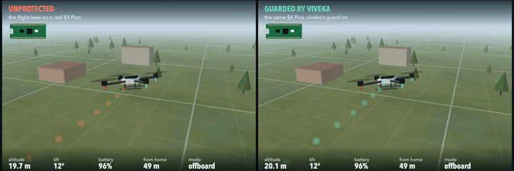

# viveka: a brain that learns and reasons in 8 KB

[](flight/README.md)

**A broken update goes to two drones in flight. One crashes. The one guarded by viveka catches it as it loads, and flies on.** The flight laws, the brain and
the guard run on a real $4 Raspberry Pi Pico; PX4 and the drone are simulated. [The film and every number](flight/README.md)

viveka is a brain for the smallest devices. It learns and reasons with **about 8 KB of memory**: about **5 KB** of
state and at most **3 KB** of stack. It needs no stored model, no training run, no cloud, no operating system and no
heap.

**edai, this repository, is viveka's public home:** the compiled brain, version 1.2 (`brain/`), and the results of its tests. viveka's source is private, and so is the
code of the newer tests (flight, self-healing, swarm, shake, video).

| What it did | The result |
|---|---|
| [**Kept a drone flying through a broken update**](flight/README.md) | 26 of 26 broken updates caught as they loaded, on a real $4 Pico; learned the four flight laws on the chip in 0.93 s; 8,420,984 answers the same as the computer's |
| [**Healed code while it runs**](heal/README.md) | 167 of 167 planted bugs healed, 0 false alarms in 240,000 calls; on the $4 Pico every one of 323,500 decisions the same; live: 16,082 wrong answers became 842 |
| [**Beat itself as a swarm**](swarm/README.md) | 129 small brains against one on 3,000 unseen problems: 53 gained, 0 lost; with a queen that remembers, 879 of 1,000 against 793 |
| [**Read NASA spacecraft**](space/README.md) | an exact rule in 39.5% of 508,502 windows, exactly right on 95.7% of those; about 4,900 times less memory than the benchmark's LSTMs |
| [**Reasoned through shaking**](shake/README.md) | 270 of 270 right, 0 wrong in 525, every fault flagged, 543 of 543 lines the same on the Pico |
| [**Carried video shots as exact maths**](video/README.md) | four shots in 394 bytes, every frame exact, 580 of 580 lines the same on Mac, browser, iPhone and Pico |
| [**Fitted an Arduino Uno**](uno/README.md) | 9 of 9 right, peak memory 1,901 of 2,048 bytes |

- **AM reasons.** From a handful of examples it finds the exact rule, made of short chains of integer steps, and proves
  it before answering. An exact answer never contradicts an example.
- **A small net learns.** When there is no rule, it learns the examples on the spot and checks itself on examples it
  hid from itself before it estimates. It also shows AM where to search.
- **Otherwise it says CANNOT.** It does not guess.

It runs on a **$4 Raspberry Pi Pico** (no floating-point unit), on phones and in browsers, on servers, and, in a
[2 KB edition](uno/README.md), on an 8-bit **Arduino Uno with 2 KB of RAM**. It gives **the same answer, bit for bit,
on every one of them**.

**The brain in `brain/` is version 1.2** (23 November 2026): AM proves its answers (1.1), and the net is AM's light (1.2). The newer tests ran on viveka's current build, 1.3,
which answers every call of 1.2 exactly as 1.2 does (its state is 5,288 bytes).

## Its strength: memory

| | the brain (1.2) | for comparison |
|---|---|---|
| The whole brain's state | **5,216 bytes**, the same object for every problem | the NASA benchmark's LSTMs (below): about **29 MB** of weights, one model per channel |
| Stack | at most **3,072 bytes** on any target; 2,888 measured on a real Pico (version 1.1) | |
| Code | about 31 KB of program space for a whole program on an Arm microcontroller | |
| Stored model or training data | **none**: it learns each problem from its own examples | trained per task, kept in memory |
| Heap, globals, operating system | **none** | |

What the 5,216 bytes hold:

| | Bytes |
|---|---|
| the problem in hand: up to 16 examples and 2 questions | 288 |
| the net's 289 learned numbers | 1,156 |
| what learning needs: two running averages and the current slope for each number | 3,468 |
| the net's 72 units and two counters | 296 |
| a check word | 8 |
| **total** | **5,216** |

It needs so little because:

1. **It keeps no model.** It learns each problem from that problem's own few examples, from scratch, and keeps nothing
   afterwards. The same 5,216 bytes serve every problem.
2. **The net is small:** 289 numbers in 32-bit floating point.
3. **AM keeps no tables.** It tries each short chain of steps in turn and keeps only the best answer for each part of
   the problem, so its whole search fits on the stack.
4. **No heap and no globals.** All state is in the one object you own: put it in static memory, on a task's stack or in
   a pool.
5. **The stack is bounded and measured.** The deepest any call goes is worked out from the compiler's frame sizes, and
   checked on real chips.
6. **Its maths is its own.** `exp`, `tanh` and square roots are the library's own code, which is also why every chip
   gives the same answers.

**And in 2 KB.** A cut-down edition keeps the same design (AM, its splitter and a net of 8 units) in **782 bytes** of
state. On a real 8-bit Arduino Uno, the whole program peaked at **1,901 of the chip's 2,048 bytes** of RAM, and it got
9 of 9 right ([`uno/`](uno/README.md)).

The trade is time: because it learns on every question, it spends time where others spend memory. That is about
20 ms a problem on a laptop. On the $4 Pico, an exact rule takes seconds, and a problem the net must learn about a
minute.

## The tests

### [Flight: a drone that survives a broken update](flight/README.md)

PX4 flew a simulated quadcopter and asked a real $4 Raspberry Pi Pico for every answer of its four flight laws. Then a broken over-the-air update came, as 72 bytes of machine code.

- **Unprotected: out of control in 0.6 s, hit the ground at 16 m/s. Guarded: caught as it loaded**, 3,892 wrong answers replaced, held its circle, reverted from the ground.
- **The brain learned the four laws on the chip in 0.93 s**, proved them on all 80,971 inputs, and kept them in 21 bytes.
- **26 of 26 broken updates caught, 0 false alarms;** 8,420,984 answers, every one the same as the computer's.
- Flown with the laws on the computer, all 26 guarded drones flew on or came home; 20 of the 26 unprotected ones crashed.
- The drone is simulated, and the four laws are ours, in whole numbers. [The films](flight/README.md) show it side by side.

### [Self-healing code](heal/README.md)

The brain learned the exact rules of a service's functions from its own calls, and guards them.

- **167 of 167 planted bugs caught and healed:** 71,557 wrong answers became 0, with 0 false alarms in 240,000 calls.
- **On the $4 Pico:** 323,500 of 323,500 decisions the same as the computer's, 4.4 µs a check, 3,648 bytes of flash and 168 of RAM.
- **Live in a running program:** 16,082 wrong answers became 842 in 20 minutes with 223 bugs deployed; Python's own 16,267 library tests ran unchanged.

### [Swarm: many small brains, and a queen](swarm/README.md)

- **129 unchanged brains beat one** on 3,000 unseen problems: 53 gained, 0 lost.
- **A big device that remembers** on top: 879 of 1,000 against 801 for the swarm and 793 for one brain.

### [Space: NASA spacecraft telemetry](space/README.md)

The brain watched NASA JPL's public telemetry from the **SMAP satellite** and the **Curiosity rover**, the benchmark of
Hundman et al. (KDD 2018): 82 channels and 105 labelled anomalies. Every window asks: here are 12 readings, what are
the next two?

- **AM answered 39.5%** of the 508,502 test windows with a rule of its own, and was **exactly right on 95.7%** of those.
- **Spikes:** the detector, fixed before scoring, caught **55 of the 62 sudden-spike anomalies, as many as the paper's
  LSTM**. In all it found 77 of the 105 anomalies.
- **With the paper's own thresholding**, the brain's forecasts reached **82.9% precision** (94.7% on the rover).
- **Memory:** the paper's LSTMs hold about 29 MB of weights (81 models, from its own published settings) and also see
  the commands sent to the spacecraft. edai is **one 5,216-byte brain for every channel**, with no training: about
  **4,900 times less memory**.
- Every number was made with the library in `brain/`, and `space/run_all.sh` makes them all again.

### [Shake: learning through vibration](shake/README.md)

Robots shake, and a small chip can't tell a pattern from the shaking on its own. So a big machine learned 9 robot
rules (drone, dish robot, cleaner) through real motor vibration, and gave a $4 Pico only the rules and their noise
allowances: **100 bytes**.

- **Exactly right on 270 of 270** shaky windows, with **no wrong answer and no false alarm**.
- **Every fault flagged:** knocks, stuck sensors, drifts, jobs it was never taught. **0 wrong answers in 525** windows.
- **On the real Pico, every one of its 543 output lines was the same as the computer's.** A window took **0.54 ms**,
  against about 62 s for the brain learning alone.

### [Video: shots as exact maths](video/README.md)

Four photo-realistic shots' maths in **394 bytes**: every frame recomputed exactly, every take judged as the records judged it, and the same 580 lines on a Mac, in WebAssembly, in a
browser, on an iPhone and on a real Pico.

### [Uno: the 2 KB edition on a real Arduino Uno](uno/README.md)

The Arduino Uno's ATmega328P is an 8-bit chip with 2 KB of RAM and no floating-point hardware. A cut-down edition of
the brain, made from version 1.0, ran on a real board: AM, its splitter and a net of 8 units, in 782 bytes of state.

- **9 of 9 right** (3 exact rules, 3 noisy trends, 3 of pure noise), and **all 9 lines the same as the computer's**.
- **Memory, measured on the chip:** the whole program peaked at **1,901 of the 2,048 bytes**. It fills 31,936 of the
  32,256 bytes of flash an Uno program can use.
- **Speed, measured on the chip:** AM applies about **27,000 steps a second** (37 µs each). An exact rule takes from
  about a second to 6 minutes, a problem with no rule 10 to 16 minutes: 92 minutes for the 9, on a board drawing 0.25
  to 0.5 W.

## Use it

```c
#include "aa.h"

static aa_brain brain;                       /* 5,216 bytes: put it anywhere */

int main(void)
{
    aa_answer a;
    aa_brain_init(&brain);
    const int64_t x[] = {55, 68, 19, 29, 95, 4, 92, 13}, y[] = {440, 544, 152, 232, 760, 32, 736, 104}, q[] = {111, 118};
    aa_solve_rule(&brain, x, y, 8, q, 2, &a);   /* a.by == AA_AM (an exact, proved rule), a.value == {888, 944} */
    return 0;
}
```

```bash
cc -std=c11 -I brain/include your.c brain/lib/macos-arm64/libaa.a -o your_program
```

- **The header:** `brain/include/aa.h` describes every call: rules (`aa_solve_rule`), sequences (`aa_solve_sequence`),
  and an online learner for sensor streams (`aa_observe`, `aa_predict`).
- **The libraries:** `brain/lib/<target>/libaa.a` for 9 targets:
  - Cortex-M0+, M4F, M33 and M7;
  - RISC-V (imc and imafc);
  - macOS on Apple silicon;
  - Linux on x86-64 and AArch64.

  Their SHA-256 sums are in `SHA256SUMS.txt`.
- **What a program needs:** on microcontrollers, only the compiler's helpers and `memset`/`memcpy`.

## The same answer on every chip

The brain gives the same answer bit for bit on every target. That has been checked:
- on a real Raspberry Pi Pico (all 300 problems of the earlier challenge, every line the same as the computer's);
- on emulated Cortex-M4F, M7, M33 and M0 cores;
- on a real Arduino Uno (the 2 KB edition: all 9 lines the same as the computer's, [`uno/`](uno/README.md));
- on phones and in browsers;
- in the shake test above (543 of 543 lines on the Pico);
- in the flight test (8,420,984 answers on the Pico) and the self-healing guard (323,500 decisions on the Pico).

Earlier versions of this repository held those runs: the 300-problem challenge, its fresh problem sets, the device
runners, the exactness and light tests, an outside challenger and the real-sensor tests. They are all in its history,
up to commit `b3c00e9`.

## What is here

| Path | What it holds |
|---|---|
| `brain/include/aa.h`, `brain/lib/<target>/libaa.a` | the compiled brain for 9 targets, and its header |
| `flight/` | the flight test: the films, the flights' records and every result |
| `heal/` | self-healing code: every result, on the computer, on the Pico, live and against tampering |
| `swarm/` | many brains against one, and the queen: every result |
| `video/` | video shots as exact maths: every result |
| `space/` | the NASA telemetry test: the program, the scripts, the protocol fixed before scoring, and the results |
| `shake/` | the shake test: what was done and every result |
| `uno/` | the 2 KB edition on a real Arduino Uno: the board's log, the computer's reference and the results |
| `SHA256SUMS.txt` | the libraries' SHA-256 sums |
