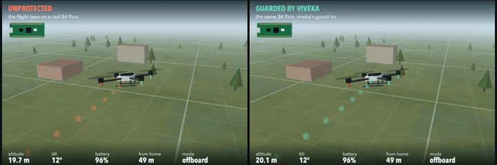
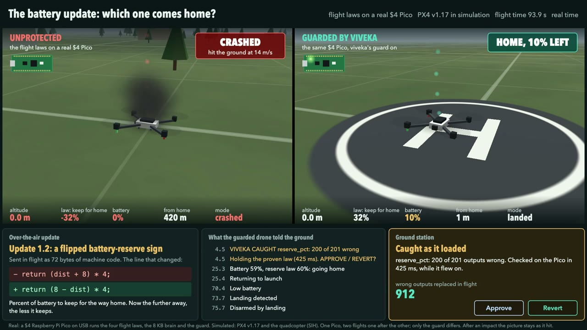

# A drone that survives a broken update



The same broken over-the-air update goes to two drones in flight. They fly the same program, and only viveka's guard differs.
The unprotected drone crashes. The guarded one catches the update **as it loads**, holds the law it has proved, and asks the ground:
Approve or Revert?

- **[viveka-flight-pico.mp4](viveka-flight-pico.mp4)** (83 s): the flight laws, the 8 KB brain and the guard run on a real $4 Raspberry Pi Pico.
- **[viveka-flight.mp4](viveka-flight.mp4)** (83 s): the same two scenes with everything on a computer.

## What we achieved

**On the real $4 Pico.** PX4, the open-source flight stack, flew a simulated quadcopter and asked the chip for every answer of the four
flight laws. The updates went to the chip as **68 to 84 bytes of machine code** over USB.

| Flown on the Pico | Unprotected | Guarded |
|---|---|---|
| **Flipped roll gain**: one character of a 14-line update, one 2-byte instruction on the chip | out of control 0.6 s after it was sent, hit the ground at 16 m/s | caught; 3,892 wrong answers replaced in flight; 1.31 m off its moving point while holding, against 1.25 m before; reverted from the ground at 30 s |
| **Flipped battery-reserve sign** | never turned back; 0% in the air 420 m from home; hit the ground at 14 m/s | caught; turned for home by its proven law; landed 0.9 m from the pad with 10% left |
| **Sensor scaling bug** (gyro 16 times too big) | flew 193 m off its path | caught; 11,629 wrong answers replaced; at most 2.1 m off |

- **The brain learned on the chip.** From the laws' own answers it found all four and proved them on **all 80,971 inputs in 0.93 s**. They
  take **21 bytes**, the same bytes as on the computer.
- **26 of 26 broken updates caught** as they loaded. The chip runs a new update on every input in **0.41 s** on one core, while the other core flies on.
- **0 false alarms:** 3 of 3 harmless rewrites (other code, the same answers) were trusted by themselves.
- **Every answer the same as the computer's:** 8,420,984 answers compared, 454 of 454 result lines equal.
- **Damaged updates refused:** 83 of 83 (one bit flipped on the way).
- **A change that is meant**, approved from the ground: the brain learned the new law again on the chip in 0.13 s.
- **Small:** a check takes 5.1 to 5.8 microseconds. The guard alone is **3,476 bytes of flash and 124 bytes of RAM** (linked on its own, with the
  compiler's 64-bit helpers), and on the chip it passed the same test without the brain: 26 of 26, 447 of 447 lines.

**26 different broken updates, each flown by both drones** (these with the laws on the computer):

| | Crashed | Out of control or off course | Flew on or came home |
|---|---|---|---|
| Unprotected | 20 (hit the ground at 6 to 16 m/s) | 3 | 3 |
| **Guarded** | **0** | **0** | **26** |

The guarded drones on the circle were at worst 1.9 m from the moving point they follow; with a harmless update, either drone was at worst 1.9 m off as
well. Those on the battery flight landed at home with 14 to 15% left.



## How it works

1. **At start** the 8 KB brain takes a few answers of each flight law, finds its exact rule, and proves it on every input the law can get.
2. **As an update loads**, it is run on every input, before one of its answers flies. Any difference is told to the ground.
3. **In flight**, every answer that is not the proven law's is replaced by it, until a person says **Approve** (the brain learns the new
   law, and proves it) or **Revert**.

It spends no tokens and needs no cloud. Nobody wrote a rule or a test for these laws: only the range of each law's inputs is given.

The update that crashed the drone is 14 lines of C, and one character is wrong:

```diff
-static int32_t roll_torque(int32_t err)  { return err * 12 * 12; }
+static int32_t roll_torque(int32_t err)  { return err * -12 * 12; }
```

## What is real, and what is simulated

- **Real:** the Raspberry Pi Pico (RP2040, 125 MHz, no floating-point unit), the four flight laws, the brain, the guard, and the updates as
  machine code run on it.
- **Simulated:** PX4 v1.17 and its quadcopter physics (SIH), on a Mac. Simulated time stands still while the chip answers (0.25 to 0.30 ms a
  trip). No real drone flew, and the Pico is not a flight board with sensors and motors.
- **The laws are ours**, written in whole numbers inside PX4. That is what viveka guards; PX4's own floating-point controllers are not guarded.
- **The update** is a file (on the computer) or machine code in the Pico's RAM, and a command. It is not a radio and a flash writer, and it is not signed.
- **Bugs outside the four laws**, code that never returns and code that crashes the processor are not caught.
- **One Pico:** the unprotected flight first, then the guarded one. Three bugs were flown on the chip. All 26 were run on the chip on every
  input; their flights had the laws on the computer.
- **PX4's own battery failsafe** was on, as its simulation sets it. With a battery of 100 seconds it began to land too late, 420 m from home.
- **Of the 3 bugs the unprotected drone survived**, two (a gain ten times too big) did no harm. The third left it 10.4 m off its path: an earlier run of the same 26
  counted that one as off course (the line is 12 m), so 24 were hurt there. The guarded drone came through 26 of 26 both times.
- **Changed after seeing first flights**, before any result here, for both drones alike: the reserve law became `(dist + 8) * 4` (it was `(dist + 5) * 4`, too thin a
  margin at home) and the landing was made quicker.
- After an impact the film shows the drone as it hit (the simulator has no wreck). The simulator refills the battery of a drone whose motors are
  off, so the records keep the last reading of the flight.
- The brain here is viveka's current build (1.3), which answers every call of the 1.2 library in `brain/` exactly as 1.2 does, plus what the guard needs. Its
  source, and the code of this test, are not published.

## Files

| Path | What it is |
|---|---|
| `viveka-flight-pico.mp4`, `viveka-flight.mp4` | the films, 1920×1080 |
| `results/on-the-pico.md`, `results/on-the-mac.md` | the results, printed from the records alone |
| `results/26-updates.json`, `.txt` | the 26 broken updates and the 3 harmless ones, each flown by both drones |
| `results/chip-check.txt`, `chip-check-guard-alone.txt` | the test on the Pico, with the brain and without it |
| `results/records/*.json.gz` | every flight of the films, 50 times a second: position, attitude, motors, battery, what the drone said (`pico-` is on the chip; `pico-A1` is the sensor scaling bug) |
